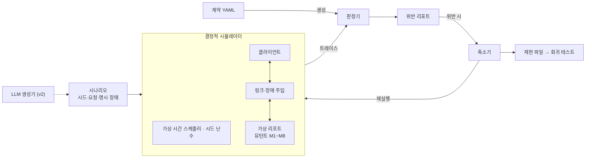

# replayspect v0 설계

> 원본: claude.ai 문서 "replayspect v0 설계". 이 파일은 저장소용 사본이다.

## 개요

v0의 목표는 LLM 없이, 동작 계약 하나로 가상 리프트 연동의 재시도·지연·중복 결함을 결정적으로 찾아내고 같은 시드로 똑같이 재현하는 것이다. LLM은 이 바닥이 단단해진 뒤 v2에서 얹는다.

**이름.** replay(실패를 그대로 다시 돌린다) + inspect(그 실행을 들여다본다). 계약 명세(spec)를 기준으로 판정한다는 뜻도 겹쳐 있다.

**풀려는 문제.** 로봇과 설비(리프트, 도어, 충전기)의 연동 프로토콜은 정상 경로보다 재시도, 타임아웃, 중복 응답, 재연결 같은 경계에서 깨진다. 이런 결함은 실장비에서 재현이 어렵고, 재현이 안 되니 고쳤는지도 확인하기 어렵다.

**v0 범위**: 파이썬 가상 리프트 장치와 클라이언트 한 쌍, YAML 동작 계약과 계약에서 생성되는 판정기, 가상 시간 이산 사건 시뮬레이터와 시드 기반 장애 주입, 뮤턴트 8개, 계약 위반 리포트와 최소화된 재현 파일.

**비목표**: LLM 시나리오 생성, 문서에서 계약 추출, 실제 TCP·Serial 통신, wirestead 연동, 범용 프로토콜 시뮬레이터.

## 핵심 개념

정답은 사람이 확정한 계약에서만 나오고, 실행은 시드만 같으면 언제나 같다.

- **동작 계약**: 구현이 아니라 관찰 가능한 행동에 대한 약속. 실행 트레이스에 대한 술어로 정의한다.
- **결정적 시뮬레이션**: 스레드와 실제 시계를 쓰지 않는다. 모든 사건은 가상 시간 스케줄러를 거치고, 장애는 시드로 초기화한 난수에서만 나온다.
- **판정 책임 분리**: 시나리오 생성(v0 무작위, v2부터 LLM)과 판정을 섞지 않는다. 판정기는 계약에서만 만들어진다.

## 아키텍처



## 계약 DSL

계약은 YAML 파일 하나다(`contracts/lift.v0.yaml`). 프로토콜의 상태 전이와 계약 목록으로 이뤄진다. 모든 계약은 트레이스만으로 판정할 수 있어야 하므로, 계약이 참조하는 값은 "시험 대상" 절의 트레이스 스키마에 정의된 이벤트 필드뿐이다. 로더와 판정기는 `src/replayspect/contract/`.

```yaml
transitions:            # [from, on, to] 삼중항. 초기 상태는 from이 null
  - [null, init, DOWN]
  - [DOWN, MOVE_UP, MOVING_UP]
contracts:
  - id: C2
    kind: exactly_once
    per: req_id
    start: client.send(MOVE_UP|MOVE_DOWN)
    event: client.handle(DONE|ERROR)
    within: 15s
```

전이를 `{from, on, to}` 매핑이 아니라 삼중항으로 쓰는 이유: PyYAML이 따르는 YAML 1.1은 따옴표 없는 `on` 키를 불리언 `true`로 읽는다. 로더는 이름 자리에 순수 문자열이 아닌 값이 오면 거부하므로 `yes`/`no`/`on`/`off`를 이름으로 쓴 실수도 잡힌다.

**이벤트 패턴**: `actor.kind` 또는 `actor.kind(NAME|NAME...)`. 예: `client.send(MOVE_UP|MOVE_DOWN)`, `device.state`.

**피연산자**: `req_id`, `name`, `actor`, `kind`, `t_us`, `data.<필드>[.<필드>...]`, 리터럴(`'문자열'`, 정수, `null`), `last(<패턴>).<피연산자>`(현재 이벤트 이전에 패턴과 일치한 가장 최근 이벤트, 없으면 `null`). **조건**: `<피연산자> == <피연산자>` 또는 `!=`. 임의의 코드는 허용하지 않는다.

**계약 C1~C8** (전체는 `contracts/lift.v0.yaml`)

| ID | 종류 | 내용 |
| --- | --- | --- |
| C1 | at_most_once | 모터 시작은 req_id당 최대 1회 (안전 계약) |
| C2 | exactly_once | 클라이언트는 이동 명령을 첫 송신 후 15초 안에 정확히 한 번 닫는다 |
| C3 | state_machine | 장치 상태는 선언된 전이로만, 직전 상태에서 출발해 바뀐다 |
| C4 | forbid | 클라이언트는 그 명령의 req_id를 단 DONE으로만 명령을 완료한다 |
| C5 | consistent | STATUS_REPLY는 장치의 현재 상태(마지막 `device.state`)를 보고한다 |
| C6 | at_most_one_open | 클라이언트가 동시에 열어 둔 이동 명령은 하나뿐이다 |
| C7 | count_le | 장치의 종료 응답 수는 그 req_id로 받은 요청 수를 넘지 않는다 |
| C8 | mutually_exclusive | 장치는 같은 req_id에 DONE과 ERROR를 모두 보내지 않는다 |

**계약 종류와 보고 시점.** 모든 위반은 그것을 증명하는 **가장 이른 이벤트**에서 보고한다. 실행이 끝나야 알 수 있는 위반은 `seq = len(trace)`로 보고한다.

| 종류 | 키 | 의미 | 보고 시점 |
| --- | --- | --- | --- |
| at_most_once | `event` | 키별 최대 1회 | 두 번째 발생 |
| exactly_once | `start`, `event`, `within` | `start`가 처음 나온 키마다 `event`가 정확히 1회, 그 첫 `start` 후 `within` 이내. 시작되지 않은 키의 `event`는 무시 | 늦은 첫 발생, 두 번째 발생, 또는 기한이 지나도록 없으면 실행 끝 |
| state_machine | `event` | `(data.from, data.on, name)`이 선언된 전이이고, `data.from`이 직전 상태 이벤트의 `name`과 같다(처음엔 `null`) | 해당 상태 이벤트 |
| forbid | `event`, `when` | `when`이 참인 `event` 금지 | 해당 이벤트 |
| consistent | `event`, `field`, `equals` | 모든 `event`에서 `field == equals` | 해당 이벤트 |
| at_most_one_open | `opens`, `closes` | `opens`가 나올 **때마다** 그 키가 열린다(닫힌 키도 다시 열림). `closes`가 닫는다. 다른 키가 열려 있는데 `opens`가 나오면 위반 | 그 `opens` 이벤트 |
| count_le | `event`, `bound` | 매 `event` 시점에 키별 누적 `event` 수 ≤ 누적 `bound` 수 | 초과한 `event` |
| mutually_exclusive | `events` | 키별로 나열한 패턴 중 둘 이상 일치 금지 | 두 번째 패턴이 처음 일치한 이벤트(키당 한 번) |

`exactly_once`의 `start`와 `at_most_one_open`의 `opens`는 일부러 다른 키워드다. 앞의 것은 키마다 **첫** 이벤트만 기준 시각으로 쓰고, 뒤의 것은 **매** 이벤트가 키를 연다. M8이 닫은 명령을 재전송해 다시 여는 경로를 C6이 잡는 것은 뒤의 의미 덕분이다.

**C1에 대해.** 처음에는 M1·M2(중복 제거 결함)를 C1으로 잡으려 했다. 하지만 장치가 실행 직전에 상태를 검사하므로, 늦게 온 중복은 이중 동작이 아니라 `ERROR`로 끝난다. 그래서 중복 제거 결함의 실제 피해는 "리프트는 움직였는데 클라이언트는 실패로 받는" 응답 불일치(C8)로 나타난다. C1은 상태 검사가 무너지는 경우를 막는 안전 계약으로 남긴다. v0 뮤턴트 중 C1을 직접 겨냥하는 것은 없어, C1은 손으로 만든 트레이스로만 검증한다.

## 시험 대상: 가상 리프트와 클라이언트

구현은 `src/replayspect/sut/lift.py`. 모든 메시지에 `req_id`가 있다.

**장치.**

1. 이동 요청을 받으면 먼저 결과 테이블을 본다. 아는 `req_id`면 저장된 결과(진행 중이면 `ACK`, 끝났으면 `DONE`/`ERROR`)를 다시 보내고 끝. 새 `req_id`면 `ACK`로 기록하고 `ACK`를 보낸 뒤, 처리 지연(50ms) 후 2단계로 넘긴다.
2. 2단계에서 현재 상태로 합법성을 본다. `MOVE_UP`은 `DOWN`에서만, `MOVE_DOWN`은 `UP`에서만 합법. 불법이면 결과를 `ERROR`로 하고 `ERROR`를 보낸다. 합법이면 `motor_start`, `MOVING_*`로 전이, 3초 뒤 `motor_stop`, `UP`/`DOWN`으로 전이, 결과를 `DONE`으로 하고 `DONE`을 보낸다.
3. 결과 테이블은 재연결 후에도 유지된다. 재연결 후 장치는 스스로 아무것도 보내지 않는다(복구는 클라이언트가 주도).

**클라이언트.**

- 이동 명령은 한 번에 하나만 연다. 이전 명령이 끝나고 생각 시간(1~3초, `fork_rng("lift/client")`) 뒤에 다음 명령을 낸다. `MOVE_UP`과 `MOVE_DOWN`을 번갈아 낸다.
- `ACK`가 2초 안에 없으면 **같은 `req_id`로** 재전송, 최대 2회. 그래도 없으면 `ERROR`(cause `ack_timeout`)로 닫는다.
- 첫 송신 후 15초 안에 `DONE`/`ERROR`가 없으면 `ERROR`(cause `done_timeout`)로 닫는다.
- `DONE`/`ERROR`는 `req_id`가 열린 명령과 같을 때만 처리하고 나머지는 무시한다.
- 재연결 후 열린 명령이 있으면 같은 `req_id`로 다시 보낸다.
- 1초마다 `STATUS`를 보낸다(`s-NNNN`, 이동 명령은 `r-NNNN`). 응답에 따라 행동하지는 않는다.

**트레이스 스키마** (채널이 `send`/`recv`/`fault`를, 엔드포인트가 아래를 기록한다)

| 이벤트 | 기록 내용 |
| --- | --- |
| 장치 `state` | `name`=새 상태, `req_id`=원인 명령(초기 상태는 `None`), `data={from, on}`. `on`은 `MOVE_UP`, `MOVE_DOWN`, `arrived`, `init`. 장치의 현재 상태는 마지막 `state` 이벤트의 `name`이다 |
| 장치 `effect` | `motor_start {dir}`, `motor_stop`, `req_id` 포함 |
| 클라이언트 `handle` | `name`=`DONE`/`ERROR`, `req_id`=닫는 명령, `data={msg_req_id, cause}`. `msg_req_id`는 계기가 된 메시지의 `req_id`(타임아웃이면 `None`), `cause`는 `reply`/`ack_timeout`/`done_timeout` |

뮤턴트는 동작만 바꾸고 기록 방식은 바꾸지 않는다. 트레이스는 결함 있는 구현이 실제로 한 일을 정직하게 남긴다.

**뮤턴트 8개와 검출 결과** (무작위 장애 `SEARCH_PROFILE`, 시드 0~999)

| ID | 위치 | 결함 | 잡는 계약 | 검출 시드 수 | 첫 검출 시드 |
| --- | --- | --- | --- | --- | --- |
| M1 | 장치 | 중복 제거 없음 | C8 | 995 | 0 |
| M2 | 장치 | req_id를 수락 시점이 아니라 완료(DONE) 시점에 기록 | C8 | 959 | 0 |
| M3 | 장치 | 재연결 후 마지막 DONE을 요청 없이 재전송 | C7 | 996 | 0 |
| M4 | 장치 | 이동 중 반대 방향 명령 수락 | C3 | 19 | 58 |
| M5 | 장치 | 이동 중 STATUS에 이동 전 상태 응답 | C5 | 1000 | 0 |
| M6 | 클라이언트 | 재시도 때 새 req_id 발급 | C6 (+C2) | 990 | 0 |
| M7 | 클라이언트 | req_id와 무관하게 아무 DONE으로나 열린 명령 완료 | C4 | 344 | 1 |
| M8 | 클라이언트 | ack 타임아웃 후 다음 명령 전까지 명령을 열어 둠 | C2 (+C6) | 144 | 5 |

결함 없는 구현은 같은 1,000개 시드에서 위반 0건이다. 각 뮤턴트는 표의 계약 외에는 위반하지 않는다(`tests/test_lift.py`가 시드 100개로 확인).

괄호 안 계약은 결함의 직접적인 결과라 함께 걸린다. M6은 재시도 때 원래 `req_id`를 버리므로 그 명령이 영영 닫히지 않아 C2도 위반한다. M8은 닫은 명령을 열린 것으로 착각한 채 재연결 후 그 명령을 다시 보내므로 C6도 위반한다.

M4(약 2%)와 M8(약 14%)은 무작위 장애로 잘 안 잡힌다. M4는 "클라이언트가 포기한 명령을 장치가 늦게 실행하는 중에 다음 명령이 도착"하는 조합이 필요하다. v2에서 LLM 시나리오 생성이 겨냥할 1차 대상이다.

## 장애 주입 모델

장애는 장치와 클라이언트 사이 링크에서만 일어나고, 모든 무작위성은 시드 하나에서 나온다. 같은 시드, 같은 코드 버전이면 트레이스가 바이트 단위로 같아야 한다.

| 장애 | 파라미터 | 노리는 결함 |
| --- | --- | --- |
| 지연 | 분포(고정·균등), us 단위 | 타임아웃·재시도 경계 |
| 유실 | 확률 | 재시도 경로 |
| 중복 | 확률, 중복본 추가 지연 | 멱등성 |
| 순서 뒤바뀜 | 지연 지터로 자연 발생 | 늦은 응답 처리 |
| 연결 끊김 | 시각, 지속 시간 | 재연결·재전송 |

무작위 모드는 방향별로 분리된 RNG 스트림에서 장애를 뽑고, 명시 모드는 계획(`FaultPlan`)에 적힌 장애만 적용한다. 명시 계획은 메시지를 `MsgKey(dir, msg, req_id, k)`, 즉 "방향, 메시지 이름, 요청 ID, 그 요청의 몇 번째 송신"으로 지정한다. 시각으로 지정하면 앞선 지연이 바뀔 때, 방향별 전체 순번으로 지정하면 재시도 하나가 생기거나 사라질 때 다른 메시지를 가리키게 되어 축소에 불안정하다. 요청 단위 키는 그 요청 안에서만 번호가 바뀐다. 연결 끊김만 시각(`t_us`)과 지속 시간으로 지정한다.

계획은 기본 지연(`delays`, 모든 송신)과 장애(`faults`, `disconnects`)를 분리한다. 모든 송신은 유실되더라도 지연을 추첨해 기록하므로, 축소기가 유실이나 끊김을 빼면 그 메시지는 원래 뽑혔던 지연으로 도착하고 다른 메시지의 타이밍은 유지된다. 다만 장애를 빼서 메시지 흐름 자체가 바뀌면(예: 유실을 빼서 재시도가 사라짐) 그 요청의 이후 동작은 달라질 수 있다.

두 모드는 실제로 적용된 결정을 트레이스에 같은 형식으로 남긴다(송신 이벤트의 `link.delay_us`, `fault` 이벤트). 그래서 `FaultPlan.from_trace`로 무작위 실행을 명시 계획으로 바꾸면 같은 다이제스트로 재생된다. 계획은 링크만 고정하고, 엔드포인트의 무작위성(클라이언트 생각 시간 등)은 여전히 시드에서 나오므로 재현에는 시드와 계획이 함께 필요하다. 축소기는 이 계획에서 항목을 빼 가며 동작한다. 링크 파라미터는 v3에서 wirestead의 장애 주입 Transport 래퍼와 같은 체계로 맞춘다.

## 판정기

`judge(trace, contracts, end_us)`가 계약마다 판정기를 만들고, 트레이스 이벤트를 순서대로 한 번씩 흘려보내 위반을 모은다.

```python
class Checker:
    def on_event(self, ev: Event, last: dict[EventPattern, Event]) -> list[Violation]: ...
    def on_end(self, end_us: int, end_seq: int) -> list[Violation]: ...

@dataclass(frozen=True)
class Violation:
    contract: str      # 계약 ID
    req_id: str | None # 키
    seq: int           # 위반을 증명하는 가장 이른 이벤트, 실행 끝이면 len(trace)
    detail: str
```

```json
{"seq":40,"t_us":2150000,"actor":"device","kind":"recv","name":"MOVE_UP","req_id":"r-0003","data":{"link":{"dir":"c2s","n":3,"k":0,"copy":0}}}
{"seq":42,"t_us":2200000,"actor":"device","kind":"effect","name":"motor_start","req_id":"r-0003","data":{"dir":"up"}}
```

**실행 종료 시각은 명시적으로 받는다.** `end_us`는 시뮬레이션을 돌린 시각(`run_until`)이다. 마지막 이벤트 시각으로 대신하면, 기한 검사(C2)가 실행 끝 무렵에 우연히 기록된 이벤트가 있느냐에 따라 뒤집힐 수 있다.

**판정기의 정답은 참조 오라클이다.** `tests/lift_oracle.py`는 C1~C8의 의미를 손으로 쓴 코드로 고정한다. 판정기는 **(실행, 계약)마다 첫 위반의 seq**가 오라클과 같아야 한다. 위반 여부만 비교하면 엉뚱한 지점에서 잡아도 통과하고, 위반 목록 전체를 비교하면 두 번째 이후 위반의 보고 방식까지 맞춰야 해서 과하다. 첫 위반 이후를 어떻게 보고할지는 판정기 재량이다.

WO-006 시점에 정상 구현과 뮤턴트 8개를 각각 시드 1,000개(실행 9,000회)로 돌려, 판정기와 오라클의 첫 위반이 모두 일치함을 확인했다. 테스트는 시드 100개로 같은 비교를 한다.

## 실행기, 재현 파일, 축소

구현은 `src/replayspect/runner.py`, `src/replayspect/shrink.py`, 명령행은 `python3 -m replayspect`.

**실행기.** 시스템(v0은 `lift.v0`: 리프트 실행 함수 + 계약 파일 + 실행 시간)을 시드 하나, 뮤턴트, 계획(없으면 무작위 장애)으로 돌리고 판정한다. 탐색은 여러 시드를 돌려 계약별 위반 실행 수와 첫 위반 시드를 센다. 이때 **배치 전체에서 한 번도 일치하지 않은 계약 패턴**을 함께 보고한다. 패턴이 아무것도 보지 못한 계약은 위반할 수가 없으므로, 메시지 이름 오타가 "위반 없음"과 똑같이 보이는 것을 막는다. 예를 들어 정상 리프트를 시드 5개만 돌리면 `device.send(ERROR)`가 한 번도 나오지 않아 C8이 아직 검증되지 않았다고 경고한다(시드 50개면 사라진다).

**재현 파일** (`replayspect.repro/1`, JSON)

```json
{
  "format": "replayspect.repro/1",
  "system": "lift.v0",
  "harness": {"version": "0.0.1", "git": "<커밋 또는 null>"},
  "seed": 65,
  "mutants": ["M4"],
  "until_us": 90000000,
  "target": "C3",
  "plan": {"delays": [...], "faults": [...], "disconnects": [...]},
  "expect": {
    "digest": "<트레이스 SHA-256>",
    "first_violations": [{"contract": "C3", "seq": 88, "req_id": "r-0003"}]
  },
  "shrink": {"faults_before": 56, "faults_after": 3, "runs": 30, "default_delay_sends": 30}
}
```

재현에는 시드와 계획이 함께 필요하다(계획은 링크를, 시드는 엔드포인트의 난수를 고정한다). 실행 시간 `until_us`도 저장한다. 판정기는 이 값을 `end_us`로 받고, 마지막 이벤트보다 이르면 거부한다. `first_violations`는 계약마다 첫 위반을 `(seq, req_id)` 순으로 정렬해 담는다. 같은 seq에 여러 키가 위반하면 `req_id`가 작은 쪽(`null`이 가장 앞)을 고른다.

**재생** (`python3 -m replayspect replay <파일>`)은 같은 시드·뮤턴트·계획·실행 시간으로 다시 돌려 세 가지를 확인한다: 다이제스트가 같은가, 첫 위반 목록이 같은가, 목표 계약이 위반되는가. 셋 다 맞아야 성공이다.

**축소.** 실패한 무작위 실행을 `FaultPlan.from_trace`로 명시 계획으로 바꾼 뒤, 장애(메시지 유실·중복, 연결 끊김)를 빼 가며 **목표 계약이 여전히 위반 목록에 있는 동안** 줄인다. 기본 지연은 빼지 않는다(장애가 아니라 원래 실행의 타이밍이다). 먼저 장애를 전부 빼 보고, 그다음 큰 덩어리부터 반씩 줄여 가며 빼고, 마지막에 하나씩 빼서 더 뺄 수 없을 때(1-최소) 멈춘다.

"같은 위반"을 첫 위반의 seq나 req_id로 판단하지 않는 이유: WO-006 리뷰에서 장애 하나만 빼도 위반이 유지된 실행 중 상당수에서 첫 위반 seq가 바뀌었다(M2/C8 1,936건 중 253건, M8/C2 96건 중 50건). 앞쪽 이벤트 수가 달라지기 때문이다. M6처럼 재시도 수에 따라 뒤 명령의 req_id가 밀리는 경우도 있다. seq와 다이제스트는 "주어진 계획이 정확히 같은 실행을 내는가"를 확인할 때만 쓴다.

같은 결함이라도 시드에 따라 필요한 장애 수가 다르다(M4: 2~7개). 그래서 `search --target`은 실패한 시드를 여러 개(기본 5개) 축소해 가장 작은 것을 남긴다. `default_delay_sends`는 축소된 실행에서 계획에 지연 항목이 없어 프로필 하한 지연으로 처리된 송신 수다. 원래 실행에 없던 메시지(예: 유실을 빼서 새로 생긴 응답)가 여기에 해당하며, 원래 실행과 타이밍이 얼마나 달라졌는지 보여 준다.

**측정** (시드 0~999에서 실패한 시드를 최대 5개 축소, 가장 작은 결과)

| 뮤턴트 | 목표 | 시드 | 축소 전 장애 | 축소 후 장애 | 실행 수 | 기본 지연 송신 |
| --- | --- | --- | --- | --- | --- | --- |
| M1 | C8 | 0 | 56 | 0 | 1 | 19 |
| M2 | C8 | 1 | 71 | 0 | 1 | 34 |
| M3 | C7 | 1 | 72 | 1 | 16 | 31 |
| M4 | C3 | 65 | 56 | 3 | 30 | 30 |
| M5 | C5 | 0 | 51 | 0 | 1 | 20 |
| M6 | C6 | 1 | 71 | 0 | 1 | 38 |
| M7 | C4 | 11 | 51 | 1 | 19 | 23 |
| M8 | C2 | 5 | 59 | 3 | 41 | 31 |

장애 0개로 줄어든 경우는 기본 지연만으로 결함이 드러나는 경우다. 예를 들어 M2·M6은 왕복 지연이 ACK 타임아웃(2초)을 넘으면 장애 없이도 재시도가 생긴다.

## v0 완료 기준

1. 결함 없는 구현이 무작위 시드 1,000개에서 계약 위반 0건 (충족, WO-005·006)
2. 뮤턴트 8개 각각이 시드 1,000개 안에서 1회 이상 검출 (충족, WO-005·006)
3. 모든 재현 파일이 재실행 시 같은 트레이스 다이제스트 (충족, WO-007: `replay`가 다이제스트·첫 위반·목표 위반을 확인)
4. 축소 후 재현 계획의 장애(유실·중복·끊김) 5개 이하 (충족, WO-007: 위 표에서 최대 3개)

원래 기준 4는 "스텝과 장애 합쳐 5개 이하"였지만, 리프트 클라이언트가 명령을 스스로 내기 때문에 시나리오에 스텝이 없다. 그래서 장애 수만 센다.

v0은 이것으로 끝이다. 뮤턴트별 검출 시드 수(위 "시험 대상" 절의 표)는 v1 기준선 데이터로 쓴다. 이후 v1 Hypothesis 기준선, v2 LLM + 커버리지 피드백(1차 대상: 무작위로 잘 안 잡히는 M4, M8), v3 문서→계약 추출과 wirestead 연동.

## 열린 질문

- 저장소 공개 시점

결정된 것: 장치의 중복 제거 기억은 재연결 후에도 유지한다(클라이언트 주도 복구와 짝). 계약 DSL은 YAML로 하고, 조건식은 위의 작은 식 언어로 제한한다.
