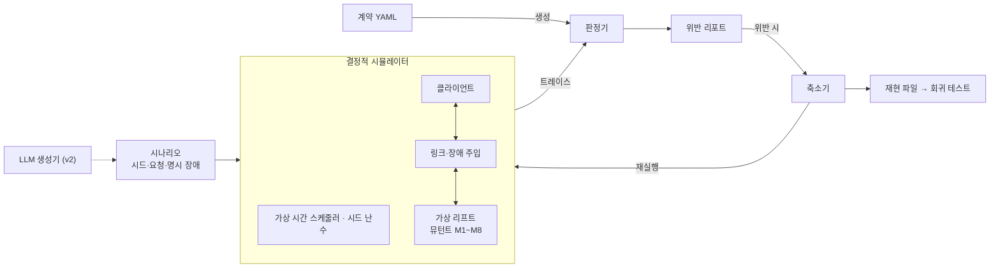

# replayspect v0 설계

> 원본: claude.ai 문서 "replayspect v0 설계". 이 파일은 저장소용 사본이다.

## 개요

v0의 목표는 LLM 없이, 동작 계약 하나로 가상 리프트 연동의 재시도·지연·중복 결함을 결정적으로 찾아내고 같은 시드로 똑같이 재현하는 것이다. LLM은 이 바닥이 단단해진 뒤 v2에서 얹는다.

**이름.** replay(실패를 그대로 다시 돌린다) + inspect(그 실행을 들여다본다). 계약 명세(spec)를 기준으로 판정한다는 뜻도 겹쳐 있다.

**풀려는 문제.** 로봇과 설비(리프트, 도어, 충전기)의 연동 프로토콜은 정상 경로보다 재시도, 타임아웃, 중복 응답, 재연결 같은 경계에서 깨진다. 이런 결함은 실장비에서 재현이 어렵고, 재현이 안 되니 고쳤는지도 확인하기 어렵다.

**v0 범위**: 파이썬 가상 리프트 장치와 클라이언트 한 쌍, YAML 동작 계약과 계약에서 생성되는 판정기, 가상 시간 이산 사건 시뮬레이터와 시드 기반 장애 주입, 뮤턴트 8개, 계약 위반 리포트와 최소화된 재현 파일.

**비목표**: LLM 시나리오 생성, 문서에서 계약 추출, 실제 TCP·Serial 통신, wirestead 연동, 범용 프로토콜 시뮬레이터.

## 핵심 개념

정답은 사람이 확정한 계약에서만 나오고, 실행은 시드만 같으면 언제나 같다.

- **동작 계약**: 구현이 아니라 관찰 가능한 행동에 대한 약속. 실행 트레이스에 대한 술어로 정의한다.
- **결정적 시뮬레이션**: 스레드와 실제 시계를 쓰지 않는다. 모든 사건은 가상 시간 스케줄러를 거치고, 장애는 시드로 초기화한 난수에서만 나온다.
- **판정 책임 분리**: 시나리오 생성(v0 무작위, v2부터 LLM)과 판정을 섞지 않는다. 판정기는 계약에서만 만들어진다.

## 아키텍처



## 계약 DSL 초안

계약은 프로토콜 정의(메시지, 상태, 전이)와 계약 목록 두 부분으로 된 YAML 하나다. 모든 계약은 트레이스만으로 판정할 수 있어야 하므로, 계약이 참조하는 값은 "시험 대상" 절의 트레이스 스키마에 정의된 이벤트 필드뿐이다.

```yaml
protocol: lift.v0
messages:
  request:  [MOVE_UP, MOVE_DOWN, STATUS]
  response: [ACK, DONE, ERROR, STATUS_REPLY]
states: [DOWN, MOVING_UP, UP, MOVING_DOWN]
transitions:
  - {from: null,        on: init,      to: DOWN}
  - {from: DOWN,        on: MOVE_UP,   to: MOVING_UP}
  - {from: MOVING_UP,   on: arrived,   to: UP}
  - {from: UP,          on: MOVE_DOWN, to: MOVING_DOWN}
  - {from: MOVING_DOWN, on: arrived,   to: DOWN}

contracts:
  - id: C1   # 안전 계약
    desc: 모터 시작은 req_id당 최대 1회
    kind: at_most_once
    per: req_id
    event: device.effect(motor_start)
  - id: C2
    desc: 클라이언트는 이동 명령을 첫 송신 후 15초 안에 정확히 한 번 닫는다
    kind: exactly_once
    per: req_id
    opens: client.send(MOVE_UP|MOVE_DOWN)
    event: client.handle(DONE|ERROR)
    within: 15s
  - id: C3
    desc: 장치 상태는 선언된 전이로만 바뀐다
    kind: state_machine
    event: device.state
  - id: C4
    desc: 클라이언트는 그 명령의 req_id를 단 DONE으로만 명령을 완료한다
    kind: forbid
    event: client.handle(DONE)
    when: data.msg_req_id != req_id
  - id: C5
    desc: STATUS_REPLY는 장치의 현재 상태(마지막 device.state)를 보고한다
    kind: consistent
    event: device.send(STATUS_REPLY)
    field: state
    equals: last(device.state).name
  - id: C6
    desc: 클라이언트가 동시에 열어 둔 이동 명령은 하나뿐이다
    kind: at_most_one_open
    per: req_id
    opens: client.send(MOVE_UP|MOVE_DOWN)
    closes: client.handle(DONE|ERROR)
  - id: C7
    desc: 장치가 보내는 종료 응답 수는 그 req_id로 받은 요청 수를 넘지 않는다
    kind: count_le
    per: req_id
    event: device.send(DONE|ERROR)
    bound: device.recv(MOVE_UP|MOVE_DOWN)
  - id: C8
    desc: 장치는 같은 req_id에 DONE과 ERROR를 모두 보내지 않는다
    kind: mutually_exclusive
    per: req_id
    events: [device.send(DONE), device.send(ERROR)]
```

| 종류 | 의미 | 판정 방식 |
| --- | --- | --- |
| at_most_once | 키별 이벤트 최대 1회 | 키별 카운터 |
| exactly_once | 열린 키마다 이벤트 정확히 1회, 기한 내 | 카운터 + 종료 시 미달·기한 검사 |
| state_machine | 선언되지 않은 전이 금지 | 상태 이벤트의 (from, on, to)를 전이 테이블과 대조 |
| forbid | 조건을 만족하는 이벤트 금지 | 이벤트마다 조건식 평가 |
| consistent | 메시지 필드와 트레이스에서 추적한 상태 일치 | 송신 시점의 마지막 상태 이벤트와 비교 |
| at_most_one_open | 열린 키가 동시에 둘 이상 금지 | 열림·닫힘 이벤트로 열린 키 추적 |
| count_le | 키별 이벤트 수 ≤ 다른 이벤트 수 | 키별 두 카운터 비교 |
| mutually_exclusive | 키별로 나열한 이벤트 중 둘 이상 발생 금지 | 키별 발생 집합 |

조건식은 트레이스 이벤트 필드와 트레이스에서 추적한 값(`last(...)`)만 참조하는 작은 식 언어로 제한한다. 각 계약의 의미는 `tests/lift_oracle.py`에 손으로 쓴 판정 코드로 고정해 두었고, 계약에서 생성할 판정기는 이 오라클과 같은 결과를 내야 한다.

**C1에 대해.** 처음에는 M1·M2(중복 제거 결함)를 C1으로 잡으려 했다. 하지만 장치가 실행 직전에 상태를 검사하므로, 늦게 온 중복은 이중 동작이 아니라 `ERROR`로 끝난다. 그래서 중복 제거 결함의 실제 피해는 "리프트는 움직였는데 클라이언트는 실패로 받는" 응답 불일치(C8)로 나타난다. C1은 상태 검사가 무너지는 경우를 막는 안전 계약으로 남긴다. v0 뮤턴트 중 C1을 직접 겨냥하는 것은 없다.

## 시험 대상: 가상 리프트와 클라이언트

구현은 `src/replayspect/sut/lift.py`. 모든 메시지에 `req_id`가 있다.

**장치.**

1. 이동 요청을 받으면 먼저 결과 테이블을 본다. 아는 `req_id`면 저장된 결과(진행 중이면 `ACK`, 끝났으면 `DONE`/`ERROR`)를 다시 보내고 끝. 새 `req_id`면 `ACK`로 기록하고 `ACK`를 보낸 뒤, 처리 지연(50ms) 후 2단계로 넘긴다.
2. 2단계에서 현재 상태로 합법성을 본다. `MOVE_UP`은 `DOWN`에서만, `MOVE_DOWN`은 `UP`에서만 합법. 불법이면 결과를 `ERROR`로 하고 `ERROR`를 보낸다. 합법이면 `motor_start`, `MOVING_*`로 전이, 3초 뒤 `motor_stop`, `UP`/`DOWN`으로 전이, 결과를 `DONE`으로 하고 `DONE`을 보낸다.
3. 결과 테이블은 재연결 후에도 유지된다. 재연결 후 장치는 스스로 아무것도 보내지 않는다(복구는 클라이언트가 주도).

**클라이언트.**

- 이동 명령은 한 번에 하나만 연다. 이전 명령이 끝나고 생각 시간(1~3초, `fork_rng("lift/client")`) 뒤에 다음 명령을 낸다. `MOVE_UP`과 `MOVE_DOWN`을 번갈아 낸다.
- `ACK`가 2초 안에 없으면 **같은 `req_id`로** 재전송, 최대 2회. 그래도 없으면 `ERROR`(cause `ack_timeout`)로 닫는다.
- 첫 송신 후 15초 안에 `DONE`/`ERROR`가 없으면 `ERROR`(cause `done_timeout`)로 닫는다.
- `DONE`/`ERROR`는 `req_id`가 열린 명령과 같을 때만 처리하고 나머지는 무시한다.
- 재연결 후 열린 명령이 있으면 같은 `req_id`로 다시 보낸다.
- 1초마다 `STATUS`를 보낸다(`s-NNNN`, 이동 명령은 `r-NNNN`). 응답에 따라 행동하지는 않는다.

**트레이스 스키마** (채널이 `send`/`recv`/`fault`를, 엔드포인트가 아래를 기록한다)

| 이벤트 | 기록 내용 |
| --- | --- |
| 장치 `state` | `name`=새 상태, `req_id`=원인 명령(초기 상태는 `None`), `data={from, on}`. `on`은 `MOVE_UP`, `MOVE_DOWN`, `arrived`, `init`. 장치의 현재 상태는 마지막 `state` 이벤트의 `name`이다 |
| 장치 `effect` | `motor_start {dir}`, `motor_stop`, `req_id` 포함 |
| 클라이언트 `handle` | `name`=`DONE`/`ERROR`, `req_id`=닫는 명령, `data={msg_req_id, cause}`. `msg_req_id`는 계기가 된 메시지의 `req_id`(타임아웃이면 `None`), `cause`는 `reply`/`ack_timeout`/`done_timeout` |

뮤턴트는 동작만 바꾸고 기록 방식은 바꾸지 않는다. 트레이스는 결함 있는 구현이 실제로 한 일을 정직하게 남긴다.

**뮤턴트 8개와 검출 결과** (무작위 장애 `SEARCH_PROFILE`, 시드 0~999)

| ID | 위치 | 결함 | 잡는 계약 | 검출 시드 수 | 첫 검출 시드 |
| --- | --- | --- | --- | --- | --- |
| M1 | 장치 | 중복 제거 없음 | C8 | 995 | 0 |
| M2 | 장치 | req_id를 수락 시점이 아니라 완료(DONE) 시점에 기록 | C8 | 959 | 0 |
| M3 | 장치 | 재연결 후 마지막 DONE을 요청 없이 재전송 | C7 | 996 | 0 |
| M4 | 장치 | 이동 중 반대 방향 명령 수락 | C3 | 19 | 58 |
| M5 | 장치 | 이동 중 STATUS에 이동 전 상태 응답 | C5 | 1000 | 0 |
| M6 | 클라이언트 | 재시도 때 새 req_id 발급 | C6 (+C2) | 990 | 0 |
| M7 | 클라이언트 | req_id와 무관하게 아무 DONE으로나 열린 명령 완료 | C4 | 344 | 1 |
| M8 | 클라이언트 | ack 타임아웃 후 다음 명령 전까지 명령을 열어 둠 | C2 (+C6) | 144 | 5 |

결함 없는 구현은 같은 1,000개 시드에서 위반 0건이다. 각 뮤턴트는 표의 계약 외에는 위반하지 않는다(`tests/test_lift.py`가 시드 100개로 확인).

괄호 안 계약은 결함의 직접적인 결과라 함께 걸린다. M6은 재시도 때 원래 `req_id`를 버리므로 그 명령이 영영 닫히지 않아 C2도 위반한다. M8은 닫은 명령을 열린 것으로 착각한 채 재연결 후 그 명령을 다시 보내므로 C6도 위반한다.

M4(약 2%)와 M8(약 14%)은 무작위 장애로 잘 안 잡힌다. M4는 "클라이언트가 포기한 명령을 장치가 늦게 실행하는 중에 다음 명령이 도착"하는 조합이 필요하다. v2에서 LLM 시나리오 생성이 겨냥할 1차 대상이다.

## 장애 주입 모델

장애는 장치와 클라이언트 사이 링크에서만 일어나고, 모든 무작위성은 시드 하나에서 나온다. 같은 시드, 같은 코드 버전이면 트레이스가 바이트 단위로 같아야 한다.

| 장애 | 파라미터 | 노리는 결함 |
| --- | --- | --- |
| 지연 | 분포(고정·균등), us 단위 | 타임아웃·재시도 경계 |
| 유실 | 확률 | 재시도 경로 |
| 중복 | 확률, 중복본 추가 지연 | 멱등성 |
| 순서 뒤바뀜 | 지연 지터로 자연 발생 | 늦은 응답 처리 |
| 연결 끊김 | 시각, 지속 시간 | 재연결·재전송 |

무작위 모드는 방향별로 분리된 RNG 스트림에서 장애를 뽑고, 명시 모드는 계획(`FaultPlan`)에 적힌 장애만 적용한다. 명시 계획은 메시지를 `MsgKey(dir, msg, req_id, k)`, 즉 "방향, 메시지 이름, 요청 ID, 그 요청의 몇 번째 송신"으로 지정한다. 시각으로 지정하면 앞선 지연이 바뀔 때, 방향별 전체 순번으로 지정하면 재시도 하나가 생기거나 사라질 때 다른 메시지를 가리키게 되어 축소에 불안정하다. 요청 단위 키는 그 요청 안에서만 번호가 바뀐다. 연결 끊김만 시각(`t_us`)과 지속 시간으로 지정한다.

계획은 기본 지연(`delays`, 모든 송신)과 장애(`faults`, `disconnects`)를 분리한다. 모든 송신은 유실되더라도 지연을 추첨해 기록하므로, 축소기가 유실이나 끊김을 빼면 그 메시지는 원래 뽑혔던 지연으로 도착하고 다른 메시지의 타이밍은 유지된다. 다만 장애를 빼서 메시지 흐름 자체가 바뀌면(예: 유실을 빼서 재시도가 사라짐) 그 요청의 이후 동작은 달라질 수 있다.

두 모드는 실제로 적용된 결정을 트레이스에 같은 형식으로 남긴다(송신 이벤트의 `link.delay_us`, `fault` 이벤트). 그래서 `FaultPlan.from_trace`로 무작위 실행을 명시 계획으로 바꾸면 같은 다이제스트로 재생된다. 계획은 링크만 고정하고, 엔드포인트의 무작위성(클라이언트 생각 시간 등)은 여전히 시드에서 나오므로 재현에는 시드와 계획이 함께 필요하다. 축소기는 이 계획에서 항목을 빼 가며 동작한다. 링크 파라미터는 v3에서 wirestead의 장애 주입 Transport 래퍼와 같은 체계로 맞춘다.

## 판정기

계약 YAML을 읽어 종류별 검사기를 만들고, 트레이스 이벤트를 하나씩 흘려보내 위반을 모은다.

```json
{"seq":40,"t_us":2150000,"actor":"device","kind":"recv","name":"MOVE_UP","req_id":"r-0003","data":{"link":{"dir":"c2s","n":3,"k":0,"copy":0}}}
{"seq":41,"t_us":2150000,"actor":"device","kind":"effect","name":"motor_start","req_id":"r-0003","data":{"state":"MOVING_UP"}}
```

```python
class Checker(Protocol):
    contract_id: str
    def on_event(self, ev: Event) -> list[Violation]: ...
    def on_end(self, final: Snapshot) -> list[Violation]: ...
```

위반은 계약 ID, 키(req_id), 위반 이벤트 seq, 근거 이벤트 seq 목록을 담는다. 판정기 자체도 종류별 정상·위반 트레이스 단위 테스트로 검증하고, 결함 없는 구현을 1,000개 시드로 돌려 오탐 0을 확인한다.

## 시나리오 포맷과 재현 파일

시나리오는 "언제 무엇을 요청하고, 링크에 어떤 장애가 있는가"만 담는다. 기대 결과는 담지 않는다.

```yaml
scenario: retry-with-late-ack
seed: 7321
mutants: [M2]
init: {device_state: DOWN}
steps:
  - {t: 0.0, client: MOVE_UP}
  - {t: 8.0, client: STATUS}
faults:                      # FaultPlan.to_dict() 형식
  delays:
    - {dir: s2c, msg: ACK, req_id: r-0003, k: 0, delay_us: 2300000}       # 첫 ACK 2.3초 지연
  faults:
    - {dir: c2s, msg: MOVE_UP, req_id: r-0003, k: 1, dup_extra_us: 400000} # 재시도 중복
  disconnects:
    - {t_us: 5000000, duration_us: 1000000}
run_until: 20.0
```

재현 파일은 시나리오 원문, 실제로 뽑힌 장애 목록, 하네스 버전(git 커밋), 위반 목록, 트레이스 다이제스트를 담는다. 재실행 다이제스트가 다르면 결정성 버그다. 축소는 위반이 유지되는 동안 스텝과 장애를 하나씩 빼고 지연 값을 이분 탐색으로 줄인다(이후 ddmin).

## v0 완료 기준

1. 결함 없는 구현이 무작위 시드 1,000개에서 계약 위반 0건
2. 뮤턴트 8개 각각이 시드 1,000개 안에서 1회 이상 검출
3. 모든 재현 파일이 재실행 시 같은 트레이스 다이제스트
4. 축소 후 재현 시나리오가 스텝과 장애 합쳐 5개 이하

뮤턴트별 검출에 걸린 시드 수를 기록해 v1의 기준선 데이터로 쓴다. 기준 1과 2는 WO-005에서 손으로 쓴 오라클(`tests/lift_oracle.py`)로 먼저 확인했다(위 "시험 대상" 절의 표). 계약에서 생성한 판정기로 같은 결과를 내는 것이 남은 일이다. 이후 v1 Hypothesis 기준선, v2 LLM + 커버리지 피드백, v3 문서→계약 추출과 wirestead 연동.

## 열린 질문

- 계약 DSL: YAML vs 파이썬 내부 DSL
- 저장소 공개 시점

결정된 것: 장치의 중복 제거 기억은 재연결 후에도 유지한다(클라이언트 주도 복구와 짝).
