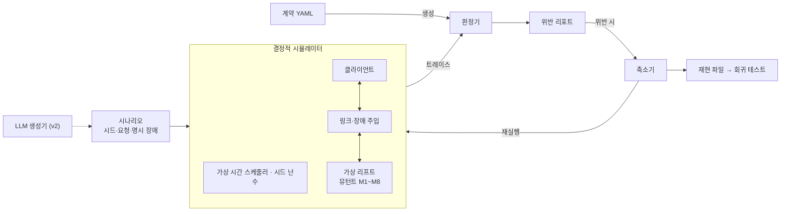

# replayspect v0 설계

> 원본: claude.ai 문서 "replayspect v0 설계". 이 파일은 저장소용 사본이다.

## 개요

v0의 목표는 LLM 없이, 동작 계약 하나로 가상 리프트 연동의 재시도·지연·중복 결함을 결정적으로 찾아내고 같은 시드로 똑같이 재현하는 것이다. LLM은 이 바닥이 단단해진 뒤 v2에서 얹는다.

**이름.** replay(실패를 그대로 다시 돌린다) + inspect(그 실행을 들여다본다). 계약 명세(spec)를 기준으로 판정한다는 뜻도 겹쳐 있다.

**풀려는 문제.** 로봇과 설비(리프트, 도어, 충전기)의 연동 프로토콜은 정상 경로보다 재시도, 타임아웃, 중복 응답, 재연결 같은 경계에서 깨진다. 이런 결함은 실장비에서 재현이 어렵고, 재현이 안 되니 고쳤는지도 확인하기 어렵다.

**v0 범위**: 파이썬 가상 리프트 장치와 클라이언트 한 쌍, YAML 동작 계약과 계약에서 생성되는 판정기, 가상 시간 이산 사건 시뮬레이터와 시드 기반 장애 주입, 뮤턴트 8개, 계약 위반 리포트와 최소화된 재현 파일.

**비목표**: LLM 시나리오 생성, 문서에서 계약 추출, 실제 TCP·Serial 통신, wirestead 연동, 범용 프로토콜 시뮬레이터.

## 핵심 개념

정답은 사람이 확정한 계약에서만 나오고, 실행은 시드만 같으면 언제나 같다.

- **동작 계약**: 구현이 아니라 관찰 가능한 행동에 대한 약속. 실행 트레이스에 대한 술어로 정의한다.
- **결정적 시뮬레이션**: 스레드와 실제 시계를 쓰지 않는다. 모든 사건은 가상 시간 스케줄러를 거치고, 장애는 시드로 초기화한 난수에서만 나온다.
- **판정 책임 분리**: 시나리오 생성(v0 무작위, v2부터 LLM)과 판정을 섞지 않는다. 판정기는 계약에서만 만들어진다.

## 아키텍처



## 계약 DSL 초안

```yaml
protocol: lift.v0
messages:
  request:  [MOVE_UP, MOVE_DOWN, STATUS]
  response: [ACK, DONE, ERROR, STATUS_REPLY]
states: [DOWN, MOVING_UP, UP, MOVING_DOWN, FAULT]
transitions:
  - {from: DOWN,        on: MOVE_UP,   to: MOVING_UP}
  - {from: MOVING_UP,   on: arrived,   to: UP}
  - {from: UP,          on: MOVE_DOWN, to: MOVING_DOWN}
  - {from: MOVING_DOWN, on: arrived,   to: DOWN}
  - {from: "*",         on: fault,     to: FAULT}

contracts:
  - id: C1
    desc: 같은 req_id의 모터 동작은 한 번만 일어난다
    kind: at_most_once
    per: req_id
    event: effect(motor_start)
  - id: C2
    desc: 클라이언트는 req_id마다 종료 응답을 정확히 한 번 처리한다
    kind: exactly_once
    per: req_id
    event: client.handle(DONE|ERROR)
    within: 15s
  - id: C3
    desc: 장치 상태는 선언된 전이로만 바뀐다
    kind: state_machine
  - id: C4
    desc: 클라이언트는 현재 요청이 아닌 req_id의 DONE을 완료로 처리하지 않는다
    kind: forbid
    event: client.handle(DONE)
    when: msg.req_id != client.current_req_id
  - id: C5
    desc: STATUS_REPLY는 응답 시점의 장치 상태와 일치한다
    kind: consistent
    event: send(STATUS_REPLY)
    field: state
    equals: device.state
```

| 종류 | 의미 | 판정 방식 |
| --- | --- | --- |
| at_most_once | 키별 이벤트 최대 1회 | 키별 카운터 |
| exactly_once | 키별 이벤트 정확히 1회, 기한 내 | 카운터 + 종료 시 미달 검사 |
| state_machine | 선언되지 않은 전이 금지 | 전이 테이블 조회 |
| forbid | 조건을 만족하는 이벤트 금지 | 이벤트마다 조건식 평가 |
| consistent | 메시지 필드와 실제 상태 일치 | 송신 시점 스냅샷 비교 |

조건식은 트레이스 이벤트 필드와 스냅샷만 참조하는 작은 식 언어로 제한한다. 임의의 파이썬 코드를 허용하면 계약이 다시 구현 코드가 된다.

## 시험 대상: 가상 리프트와 클라이언트

- **프로토콜**: 요청 `{req_id, cmd}`. 장치는 수신 즉시 `ACK`, 도착 시 `DONE`. 이동 시간은 가상 3초.
- **클라이언트**: `ACK`를 2초 안에 못 받으면 같은 `req_id`로 최대 2회 재전송. `DONE`은 15초까지 기다리고 넘기면 `ERROR`.
- **장치**: 세션 안에서 처리한 `req_id`를 기억해, 중복 요청에는 동작 없이 이전 결과만 다시 응답.

| ID | 위치 | 결함 | 걸려야 할 계약 |
| --- | --- | --- | --- |
| M1 | 장치 | 중복 제거 없음 | C1 |
| M2 | 장치 | 모터 시작 후에 req_id 기록 (지연된 중복이 끼어들면 이중 동작) | C1 |
| M3 | 장치 | 재연결 시 미완료 DONE을 두 번 재전송 | C2 |
| M4 | 장치 | 이동 중 반대 방향 명령 수락 | C3 |
| M5 | 장치 | 이동 중 STATUS에 이전 상태 응답 | C5 |
| M6 | 클라이언트 | 재시도 때 새 req_id 발급 | C1 |
| M7 | 클라이언트 | 이전 요청의 늦은 DONE을 현재 요청 완료로 처리 | C4 |
| M8 | 클라이언트 | 타임아웃 후 늦게 온 DONE을 한 번 더 처리 | C2 |

M2, M7, M8은 특정 지연·중복 조합에서만 드러난다. 정상 경로 시험으로는 잡히지 않는 결함이 섞여 있어야 이후 비교가 의미 있다.

## 장애 주입 모델

장애는 장치와 클라이언트 사이 링크에서만 일어나고, 모든 무작위성은 시드 하나에서 나온다. 같은 시드, 같은 코드 버전이면 트레이스가 바이트 단위로 같아야 한다.

| 장애 | 파라미터 | 노리는 결함 |
| --- | --- | --- |
| 지연 | 분포(고정·균등), us 단위 | 타임아웃·재시도 경계 |
| 유실 | 확률 | 재시도 경로 |
| 중복 | 확률, 중복본 추가 지연 | 멱등성 |
| 순서 뒤바뀜 | 지연 지터로 자연 발생 | 늦은 응답 처리 |
| 연결 끊김 | 시각, 지속 시간 | 재연결·재전송 |

무작위 모드는 방향별로 분리된 RNG 스트림에서 장애를 뽑고, 명시 모드는 계획(`FaultPlan`)에 적힌 장애만 적용한다. 명시 계획은 메시지를 시각이 아니라 `(dir, n)`, 즉 방향별 n번째 송신으로 지정한다. 시각 기반 지정은 앞선 지연이 바뀌면 다른 메시지를 가리키게 되어 축소에 불안정하기 때문이다. 연결 끊김만 시각(`t_us`)과 지속 시간으로 지정한다.

두 모드는 실제로 적용된 결정을 트레이스에 같은 형식으로 남긴다(송신 이벤트의 `link.delay_us`, `fault` 이벤트). 그래서 `FaultPlan.from_trace`로 무작위 실행을 명시 계획으로 바꾸면, 시드와 무관하게 같은 다이제스트로 재생된다. 축소기는 이 계획에서 항목을 빼 가며 동작한다. 링크 파라미터는 v3에서 wirestead의 장애 주입 Transport 래퍼와 같은 체계로 맞춘다.

## 판정기

계약 YAML을 읽어 종류별 검사기를 만들고, 트레이스 이벤트를 하나씩 흘려보내 위반을 모은다.

```json
{"seq":40,"t_us":2150000,"actor":"device","kind":"recv","name":"MOVE_UP","req_id":"r-0003","data":{"link":{"dir":"c2s","n":3,"copy":0}}}
{"seq":41,"t_us":2150000,"actor":"device","kind":"effect","name":"motor_start","req_id":"r-0003","data":{"state":"MOVING_UP"}}
```

```python
class Checker(Protocol):
    contract_id: str
    def on_event(self, ev: Event) -> list[Violation]: ...
    def on_end(self, final: Snapshot) -> list[Violation]: ...
```

위반은 계약 ID, 키(req_id), 위반 이벤트 seq, 근거 이벤트 seq 목록을 담는다. 판정기 자체도 종류별 정상·위반 트레이스 단위 테스트로 검증하고, 결함 없는 구현을 1,000개 시드로 돌려 오탐 0을 확인한다.

## 시나리오 포맷과 재현 파일

시나리오는 "언제 무엇을 요청하고, 링크에 어떤 장애가 있는가"만 담는다. 기대 결과는 담지 않는다.

```yaml
scenario: retry-with-late-ack
seed: 7321
mutants: [M2]
init: {device_state: DOWN}
steps:
  - {t: 0.0, client: MOVE_UP}
  - {t: 8.0, client: STATUS}
faults:                      # FaultPlan.to_dict() 형식
  messages:
    - {dir: s2c, n: 0, delay_us: 2300000}        # 첫 응답(ACK) 2.3초 지연
    - {dir: c2s, n: 1, dup_extra_us: 400000}     # 두 번째 송신(재시도) 중복
  disconnects:
    - {t_us: 5000000, duration_us: 1000000}
run_until: 20.0
```

재현 파일은 시나리오 원문, 실제로 뽑힌 장애 목록, 하네스 버전(git 커밋), 위반 목록, 트레이스 다이제스트를 담는다. 재실행 다이제스트가 다르면 결정성 버그다. 축소는 위반이 유지되는 동안 스텝과 장애를 하나씩 빼고 지연 값을 이분 탐색으로 줄인다(이후 ddmin).

## v0 완료 기준

1. 결함 없는 구현이 무작위 시드 1,000개에서 계약 위반 0건
2. 뮤턴트 8개 각각이 시드 1,000개 안에서 1회 이상 검출
3. 모든 재현 파일이 재실행 시 같은 트레이스 다이제스트
4. 축소 후 재현 시나리오가 스텝과 장애 합쳐 5개 이하

뮤턴트별 검출에 걸린 시드 수를 기록해 v1의 기준선 데이터로 쓴다. 이후 v1 Hypothesis 기준선, v2 LLM + 커버리지 피드백, v3 문서→계약 추출과 wirestead 연동.

## 열린 질문

- 장치의 중복 제거 기억 범위: 세션 단위 vs 재연결 후에도 유지
- 계약 DSL: YAML vs 파이썬 내부 DSL
- 저장소 공개 시점
